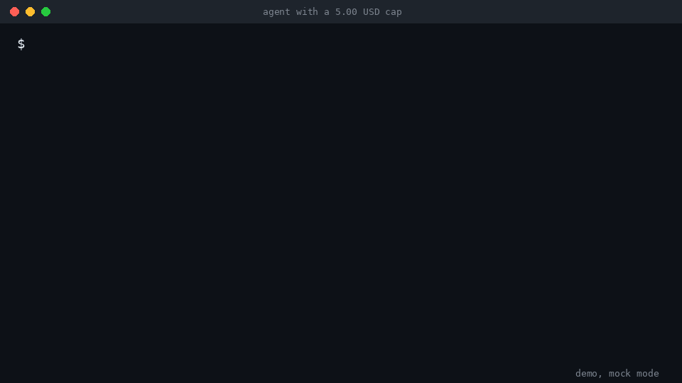

# send21-over-budget-handoff

[send21](https://send21.io/): Crypto pay links and API for people and AI agents.

An AI agent with a hard spend cap hands off to a human instead of overspending.



Agent proposes. Human signs. The key can't spend.

This is an example. It is **not an official LangGraph integration**, and not a library with a stable API.

## How it works

1. The agent runs a task under a budget (demo: spent 4.20 of 5.00 USD).
2. The next step costs 1.50 USD. 4.20 + 1.50 > 5.00, so the budget guard says "handoff" and the step does not run.
3. The agent calls the send21 MCP tool `create_payment_request` (amount, payee address, memo, `orderId`, and a `declineNote` the pay page shows as "If you don't pay:"), gets back `id` and `payPath`, prints the pay link `https://send21.io` + `payPath`, and pauses (LangGraph `interrupt()`).
4. A human opens the link and signs in their own wallet. send21 prepares the payment instructions; funds go straight from the payer's wallet to the receiver's wallet. send21 never holds keys or funds, never signs and never broadcasts.
5. send21 sends an HMAC-signed `draft.confirmed` webhook. The receiver checks the signature, ignores repeated deliveries, matches `orderId` to the paused run and resumes it (`Command(resume=...)`). The cap is raised by the confirmed amount and the task completes.

### Why the cap holds

The agent's send21 key has the `drafts:write` scope only. It can prepare a payment request. It cannot move funds, and nothing in this repo has signing code or private keys. The only way past the cap is a human signing in their own wallet.

## Quickstart (mock mode, no network, no payments)

```sh
python3.11 -m venv .venv && . .venv/bin/activate
pip install -e ".[dev]"
python scripts/run_demo.py --mock
pytest
```

Mock mode uses a fake send21 client (pay link `https://send21.io/demo`, id `demo-0001`) and posts a fake `draft.confirmed` webhook to the local receiver, signed with a local secret. Output is the same every run.

## Live mode

1. Create an API key at https://send21.io/api-keys with the `drafts:write` scope only.
2. Create a webhook endpoint in send21 pointing at `https://<your-public-host>/webhooks/send21` and keep the signing secret.
3. `cp .env.example .env` and fill in `SEND21_API_KEY`, `SEND21_WEBHOOK_SECRET`, `PAYEE_ADDRESS` (your own receiving address).
   - 🔐 **Approve your receiving address in send21.** New send21 accounts (created on or after 20 Oct 2026) only accept receiving addresses the owner approved, including Lightning addresses. Add `PAYEE_ADDRESS` in the send21 app, or propose it from an agent (MCP `propose_receiving_address`), then sign in and approve it with a passkey or authenticator code. No API key can approve an address. Older accounts can opt in under Settings.
4. Expose `WEBHOOK_PORT` with any tunnel, then `python scripts/run_demo.py --live`.
5. Open the printed pay link and pay from your own wallet.

Live mode uses mainnet networks. Use a small amount. See "Unverified" below about testnet. The public testnet demo is at https://send21.io/demo (no account needed), separate from this repo.

## Webhook verification

- Header `X-Send21-Signature-V2: t=<timestamp>,v1=<lowercase hex HMAC-SHA256 of "<timestamp>.<delivery id>.<raw body>">`, keyed with the endpoint signing secret, is checked first, on the raw bytes before parsing, in constant time. Deliveries older than 5 minutes are refused, so a copied delivery cannot be replayed.
- The legacy `X-Send21-Signature: sha256=<lowercase hex HMAC-SHA256 of the raw body>` (no timestamp) is still sent for compatibility and is used only as a fallback when no V2 header is present.
- `X-Send21-Delivery` is stored; a repeated delivery returns 200 and does nothing.
- Run status only moves forward, so late or out-of-order events cannot undo a resume.
- `draft.confirmed` resumes. `draft.amount_mismatch` marks the run for human review and does not resume. `draft.seen` is logged only.

Details follow the Webhooks section at https://send21.io/swagger and the `examples/webhook-receiver` sample in https://github.com/send21io/send21-examples for reference.

## Troubleshooting

- **422 `address_not_approved`:** the receiving address isn't approved in your send21 account, so nothing was created. Sign in to send21, approve the address (passkey or authenticator code), then try again.
- **403 `owner_not_confirmed`:** an agent created the account and the owner hasn't taken it over yet. The owner opens the emailed link and sets up a passkey or password.

## Layout

```
handoff/        framework-agnostic core (no LangGraph imports)
  budget.py       BudgetGuard: spent + cost > cap means handoff
  send21_client.py  MCP client (live) and mock client
  webhook.py      signature check, event handling, HTTP receiver
  store.py        sqlite state (runs, deliveries, events)
  agent.py        task steps and the handoff request
  mock.py         fake signed draft.confirmed
adapters/
  langgraph_agent.py  interrupt() / Command(resume=...) wiring
scripts/        run_demo.py, send_mock_webhook.py
tests/          pytest, runs fully offline
```

To use another framework, keep `handoff/` and replace the adapter: pause at the handoff, resume when the webhook calls `resume(run_id, event_data)`.

## Unverified

These are not confirmed against the live API yet. Check https://send21.io/docs and the live MCP `tools/list` before relying on them.

- `get_payment_request` and `get_rate`: argument and response shapes. Not used by the demo flow. The live client validates arguments against the server's published `inputSchema` at call time.
- The `status` and `expiresAt` values in the `create_payment_request` response, and the exact `payPath` format. Only `id` and `payPath` are relied on.
- Whether API keys can target testnet, and which network names to use (for example Testnet4 or Signet, Base Sepolia, Solana Devnet). Open question; live mode is mainnet only for now.
- Whether a key's scopes can be read through the API. The repo does not check it; you must create the key with `drafts:write` only.
- The `draft.confirmed` fixture is modeled on the documented webhook fields, not a captured live delivery.
- Live mode keeps LangGraph checkpoints in memory, so a paused run does not survive a process restart. Use a persistent checkpointer for anything beyond the demo.

## License and contact

MIT, see LICENSE. Questions: info@send21.io. Docs: https://send21.io/docs
